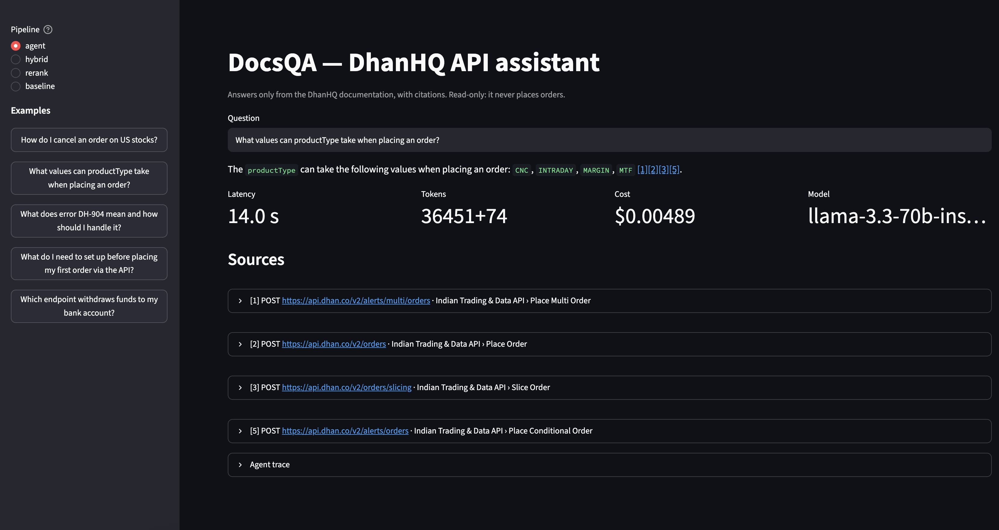
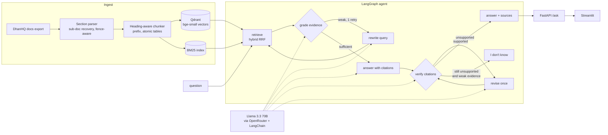

# DocsQA — an evaluated RAG assistant for the DhanHQ trading API

Ask a question about the DhanHQ API and get an answer that cites the exact documentation passages it came from, or an explicit "I don't know" when the docs don't cover it. The interesting part is not the chatbot. It is the **evaluation harness**, which measures every design decision (chunking, hybrid search, reranking, fine-tuning, long context vs. RAG, an agentic self-check) on the same question set, with confidence intervals.



*The agent pipeline answering from the Indian Trading API docs, with each `[n]` citation linked to the exact passage, plus latency, token and cost readouts.*

**Headline results** (150 answerable + 20 unanswerable questions; open-weight Llama 3.3 70B answers):

| | Vector RAG (baseline) | **Hybrid RAG** | Agent v2 (hybrid + self-check) | Whole doc in prompt (no retrieval) |
|---|---|---|---|---|
| Answer correctness | 0.860 | **0.913** | 0.887 | 0.540 |
| Faithfulness to cited passages | 0.965 | 0.980 | 0.986 | 0.187 |
| Unanswerable questions declined | 20 / 20 | 18 / 20 | **20 / 20** | 0 / 20 |
| Answerable questions wrongly declined | 4.0% | **1.3%** | 2.7% | 0% |
| Cost per 1K questions | $0.23 | **$0.19** | $0.59 | ~$24 |
| p50 / p95 latency | 2.4 s / 6.8 s | 3.1 s / 12.8 s | 7.4 s / 23.0 s | 4.6 s / 45.8 s |

- **Hybrid retrieval** (BM25 + dense, reciprocal rank fusion) raised recall@5 from 0.830 to 0.880 and correctness from 0.860 to 0.913 (paired 95% CI on the correctness gain: [0.0, +10.7] points). It fixed every cross-API disambiguation miss: identifiers like `DH-904` or `NSE_FNO` are exact-match terms that BM25 finds and small embedders blur.
- **Long context loses badly here**: putting the whole ~110K-token doc in one prompt was 32 points less correct, almost never cited correctly, answered all 20 unanswerable questions with confident fabrications, and cost ~100× more per query.
- **The agent's self-check is a trade-off, and the first version was a regression**: a strict open-weight verifier rejected verbatim quotes and arithmetic and abstained on 19% of answerable questions (−14 points correctness). Calibrating the verifier (v2) recovered 11 of those points (95% CI [+6.7, +16.7]) and kept 20/20 refusals on unanswerable questions. It still answers 4 fewer questions than plain hybrid RAG (−2.7 points, CI [−5.3, −0.7]) in exchange for 2 more correct refusals, at 3× the cost and latency. Plain hybrid RAG is the best accuracy-per-dollar; the agent is the choice when a wrong answer costs more than a missing one.
- **Fine-tuning the embedder** (875 synthetic pairs, 3 epochs) moved recall@5 by +2.0 points (vector) and +0.7 (hybrid), within noise at this eval size. Reported as a null-ish result rather than a win.

## Architecture



## Results in detail

All numbers below come from `eval/results/summary.json` (generated) and can be reproduced with the commands in [Running the evals](#running-the-evals).

### Retrieval experiments (no LLM calls)

Section-level relevance; **recall@5** counts the question's source section(s); **hit@5 (pooled)** also accepts other sections independently judged to state the same fact (the corpus repeats facts across the API reference, guides and release notes).

| Retrieval | Embedding | Chunk tokens | recall@5 | hit@5 (pooled) | MRR |
|---|---|---|---|---|---|
| Vector | bge-small-en-v1.5 | 300 | 0.793 | 0.940 | 0.806 |
| Vector | bge-small-en-v1.5 | **500** | 0.830 | 0.953 | 0.809 |
| Vector | bge-small-en-v1.5 | 800 | 0.803 | 0.933 | 0.796 |
| BM25 | – | 500 | 0.807 | 0.900 | 0.742 |
| **Hybrid (RRF)** | bge-small-en-v1.5 | 500 | **0.880** | 0.967 | 0.848 |
| Hybrid → MiniLM cross-encoder | bge-small-en-v1.5 | 500 | 0.860 | 0.973 | **0.885** |
| Hybrid → bge-reranker-base | bge-small-en-v1.5 | 500 | 0.873 | 0.953 | 0.871 |
| Vector | **fine-tuned** bge-small | 500 | 0.850 | 0.967 | 0.832 |
| Hybrid | **fine-tuned** bge-small | 500 | 0.887 | **0.980** | 0.845 |

Paired bootstrap (10K resamples over questions) for the decisions that mattered:

| Comparison (recall@5) | Δ | 95% CI | Questions better / worse |
|---|---|---|---|
| hybrid vs vector | +5.0 | [0.0, +10.3] | 13 / 6 |
| 500 vs 300 tokens (vector) | +3.7 | [+0.7, +7.0] | 8 / 1 |
| rerank (MiniLM) vs hybrid | −2.0 | [−7.0, +3.0] | 7 / 12 |
| fine-tuned vs base (vector) | +2.0 | [−3.0, +7.3] | 10 / 7 |
| fine-tuned vs base (hybrid) | +0.7 | [−3.3, +4.7] | 5 / 4 |

Recall@5 by question type:

| Retrieval | Lookup | Exact fact | Disambiguation | Multi-step |
|---|---|---|---|---|
| Vector | 0.731* | 0.872* | 0.844 | 0.684* |
| BM25 | 0.731 | **0.957** | 0.844 | 0.579 |
| Hybrid | 0.788 | **0.957** | **1.000** | 0.737 |
| Hybrid → rerank | **0.827** | **0.957** | 0.906 | 0.632 |
| Fine-tuned vector | **0.827** | 0.894 | 0.875 | **0.763** |

<sub>* vector row at 300 tokens; the 500-token run was evaluated end to end.</sub>

### End to end

| System | Correct | Faithful | Refusal acc. | False refusal | LLM calls / q | p50 / p95 s | $ / 1K q |
|---|---|---|---|---|---|---|---|
| Vector RAG | 0.860 | 0.965 | 1.000 | 0.040 | 1.0 | 2.45 / 6.77 | 0.23 |
| Hybrid RAG | **0.913** | 0.980 | 0.900 | **0.013** | 1.0 | 3.10 / 12.78 | **0.19** |
| Agent v1 (strict verifier) | 0.773 | **0.992** | **1.000** | 0.193 | 3.6 | 8.22 / 28.60 | 0.59 |
| Agent v2 (calibrated verifier) | 0.887 | 0.986 | **1.000** | 0.027 | 3.4 | 7.37 / 23.00 | 0.59 |
| Whole doc in prompt | 0.540 | 0.187 | 0.000 | 0.000 | 1.0 | 4.61 / 45.76 | ~24 |

Correctness by question type:

| System | Lookup | Exact fact | Disambiguation | Multi-step |
|---|---|---|---|---|
| Vector RAG | 0.827 | 0.957 | 0.875 | 0.684 |
| Hybrid RAG | 0.904 | 1.000 | 1.000 | 0.579 |
| Agent v1 | 0.769 | 0.894 | 0.875 | 0.316 |
| Agent v2 | 0.865 | 0.979 | 1.000 | 0.526 |
| Whole doc in prompt | 0.519 | 0.617 | 0.625 | 0.263 |

Notes on these numbers:

- Answers come from `meta-llama/llama-3.3-70b-instruct` on OpenRouter, routed to the cheapest provider. Latency therefore includes provider queueing; the same model routed for latency measured p50 0.54 s at ~2.6× the token price.
- The long-context cost is approximate: part of that run was served by providers that bill above the model's list price, and those calls were recorded at list price before billed-cost tracking was added.
- Multi-step questions are the weak spot for every system: their two source sections rarely both make the top 5.

## How the evaluation works

**Question set.** 232 questions were generated from specific documentation sections by a small model, in four types: *lookup* ("which endpoint…"), *exact fact* (enum values, limits, error codes), *disambiguation* (the same page title exists in two APIs, e.g. Cancel Order in the Indian vs. Global Stocks API, and the question names one), and *multi-step* (needs two sections). A stronger model audited each question against its source (keep / fix / drop), then a manual review dropped ambiguous items (recorded in `eval/data/manual_edits.jsonl`). 20 hand-written **unanswerable** questions test abstention, including near misses where the topic appears only as a field or enum (pledged quantity, a crypto news category) but no endpoint exists.

**Relevance.** Gold labels are section-level so one question set serves every chunk size. Because the corpus repeats facts, sections retrieved by any system were pooled and judged for whether they state the same core fact (TREC-style pooling); strict and pooled metrics are both reported.

**No leakage.** The eval/train split is by section: every section relevant to an eval question, plus disambiguation distractors, is reserved, and fine-tuning pairs are generated only from the other sections. `finetune/train.py` asserts this.

**Grading.** Correctness and faithfulness are binary, each with a one-sentence rubric (`eval/judge.py`); refusals are scored without a judge. Validation:

| Check | n | Correctness agreement (κ) | Faithfulness agreement (κ) |
|---|---|---|---|
| LLM judge (Claude Sonnet 5.5) vs. reference labels | 40 | 97.5% (0.89) | 100% (1.0, one negative) |
| Offline grader (Claude Opus 5.5) vs. LLM judge, blind, on the baseline | 145 | 97.2% (0.86) | 95.9% (0.61) |

The end-to-end comparisons above were all graded by the same offline grader, which ran about 3 points more lenient than the API judge on both dimensions; that offset is common to every row. Reference labels and curated sets are marked `label_status: draft` until manually reviewed.

**Statistics.** `python -m eval.compare A B --metric M` reports a paired bootstrap CI over questions. With 150 questions one question moves a rate by 0.67 points; several improvements here are within that noise and are reported as such.

## What didn't work

- **Cross-encoder reranking** improved MRR (0.848 → 0.885) but lowered recall@5: the MS MARCO MiniLM reranker ignores the "Global Stocks API › Cancel Order" path prefix and promotes the wrong API's page. A stronger reranker (bge-reranker-base) narrowed the gap but did not beat plain hybrid.
- **Smaller chunks** hurt: most sections are already under 300 tokens, and splitting the large ones separates parameter tables from the endpoint they describe.
- **The strict self-check** (agent v1) is the clearest regression in the project; see above.
- **Long context**: Llama 3.3 at 112K of its 128K window drifted into generic overviews and stopped following the citation format unless the instruction was repeated after the question.
- **Fine-tuning**: a small, not significant gain. With ~150 trainable sections and in-batch negatives only, there is little the base model doesn't already know; mining hard negatives across sub-docs is the obvious next step.

## Running it

Requirements: Docker, an OpenRouter key.

```bash
cp .env.example .env            # add OPENROUTER_API_KEY
# put the docs export at data/raw/dhan-api-docs.md (see "Getting the docs")
docker compose up --build       # qdrant + one-shot indexer + API :8000 + UI :8501
```

Or locally with [uv](https://docs.astral.sh/uv/):

```bash
uv sync --extra ui
docker compose up -d qdrant
uv run python -m scripts.build_index --chunk 300 500 800
uv run uvicorn docsqa.api:app --port 8000
uv run streamlit run app/streamlit_app.py
curl -s localhost:8000/ask -H 'content-type: application/json' \
     -d '{"question": "How do I cancel an order on US stocks?"}'
```

### Getting the docs

The DhanHQ documentation is not redistributed here. Export it as a single Markdown file (the DhanHQ docs site offers a full export) and save it as `data/raw/dhan-api-docs.md`.

### Running the evals

```bash
uv run python -m eval.eval --system vector --chunk 300 --retrieval-only     # free
uv run python -m eval.eval --system hybrid                                  # answers + LLM judge
uv run python -m eval.eval --system longctx
uv run python -m eval.eval --system agent-v2
uv run python -m eval.compare hybrid agent-v2 --metric correct
uv run python -m eval.validate_judge                                        # judge vs reference labels
uv run python -m finetune.gen_pairs && uv run python -m finetune.train
uv run pytest
```

Responses are cached on disk by request content, so re-running an eval after changing metrics costs nothing; cached calls keep their originally measured latency and cost. `--judge offline` exports answers for grading instead of calling the judge model.

## Repository layout

```
docsqa/ingest/   parse.py (sections, sub-docs), chunk.py (chunking, BM25 tokens)
docsqa/          embed.py, store.py (Qdrant), retrieve.py (vector/BM25/hybrid/rerank),
                 rag.py, longctx.py, agent.py (LangGraph), llm.py (OpenRouter via LangChain), api.py
eval/            gen_questions → validate_questions → pool_relevance → split,
                 eval.py, judge.py, metrics.py, compare.py, validate_judge.py, grader_agreement.py
eval/data/       question sets, curated unanswerables, reference labels
eval/results/    summary.json, results.md, judge validation reports, offline grades
finetune/        gen_pairs.py, train.py
app/             Streamlit UI
```

## Toward production

- **Caching:** an answer cache keyed on (normalized question, index version) in front of the agent; most docs traffic is repetitive.
- **Re-indexing:** the index is rebuilt from the export in seconds. In production, diff sections by content hash, re-embed only changed chunks, and version the collection so cached answers are invalidated with it.
- **Monitoring:** log refusal rate, citation count, verifier failures and per-provider latency/cost; a rising refusal rate is the earliest signal of a docs change the index has missed.
- **Cost limits:** per-request token caps, price-sorted provider routing, a hard budget guard (already enforced in the eval runner), and a cheaper model for the grading/verification steps.
- **Safety:** the service is read-only by construction: it holds no Dhan credentials and has no code path to trading endpoints.

## Limitations

- 150 answerable questions are enough to rank systems with large differences, not small ones; CIs are reported for that reason.
- The question set is synthetic (generated, audited by a model, partially reviewed by hand); real user questions are messier.
- Refusal detection matches the fixed refusal sentence; a few long-context answers abstained in free prose and were counted as answers.
